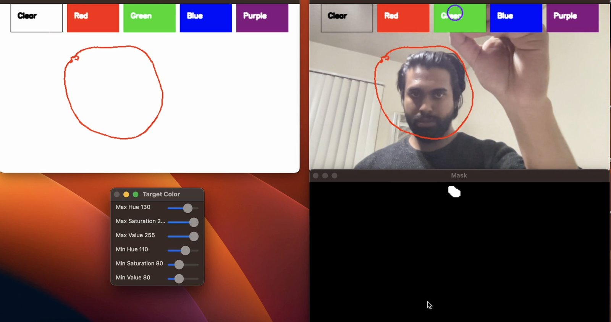

# Airbrush: Real-Time Air Drawing with Color-Marker Tracking


Airbrush turns a webcam into a drawing tablet. A colored marker worn on the fingertip is tracked in live video with classical image processing, and its path is drawn onto a virtual canvas. An on-screen palette lets you change the stroke color or clear the canvas without touching the keyboard or mouse.

<p align="center">
  
</p>
<p align="center"><sub><b>Airbrush in action.</b> <i>Left:</i> the virtual canvas with a stroke drawn in mid-air. <i>Right:</i> the mirrored webcam view with the on-screen palette (Clear, Red, Green, Blue, Purple). The tracked marker is circled, here hovering over <i>Green</i> to switch color. <i>Bottom right:</i> the binary HSV mask that isolates the blue marker. <i>Bottom left:</i> the <i>Target Color</i> sliders defining the marker's HSV range (H 110–130, S 80–255, V 80–255).</sub></p>

*Course project for EE 241 (Advanced Digital Image Processing), UC Riverside, Jan–Mar 2023. Demo video: [`EE-241-Demo.mp4`](EE-241-Demo.mp4) · report: [`Final-Report.pdf`](Final-Report.pdf) · proposal: [`Project Proposal.pdf`](Project%20Proposal.pdf)*

## How it works

```
webcam frame ──► HSV conversion ──► color threshold (mask) ──► erode / open / dilate
                                                                     │
       canvas ◄── draw stroke / change color / clear ◄── marker centre ◄── largest contour
```

1. **Capture:** frames come from the webcam through `cv2.VideoCapture` and are mirrored for natural interaction.
2. **Segment:** each frame is converted to HSV, which separates hue from brightness and makes color thresholding robust to lighting. Pixels inside the marker's HSV range form a binary mask. The range is tunable live in the *Target Color* window.
3. **Clean up:** erosion, morphological opening and dilation (5×5 kernel) remove speckle noise and fill small holes in the mask.
4. **Localize:** the largest contour in the mask is taken as the marker, and its centroid (from image moments) is the pen position.
5. **Interact:** moving the pen over a palette button changes the stroke color, moving it over *Clear* wipes the canvas, and anywhere else it draws.

## Run it

```bash
pip install -r requirements.txt     # numpy, opencv-contrib-python
python main.py
```

- You need a built-in or external webcam.
- The default marker color is **blue**. Change it by adjusting the HSV sliders in the *Target Color* window.
- Move the marker at a steady pace; very fast motion causes gaps in the stroke.
- Press `q` to quit.

Tested with Python 3.9.6, NumPy 1.24.2 and opencv-contrib-python 4.7.0.72.
